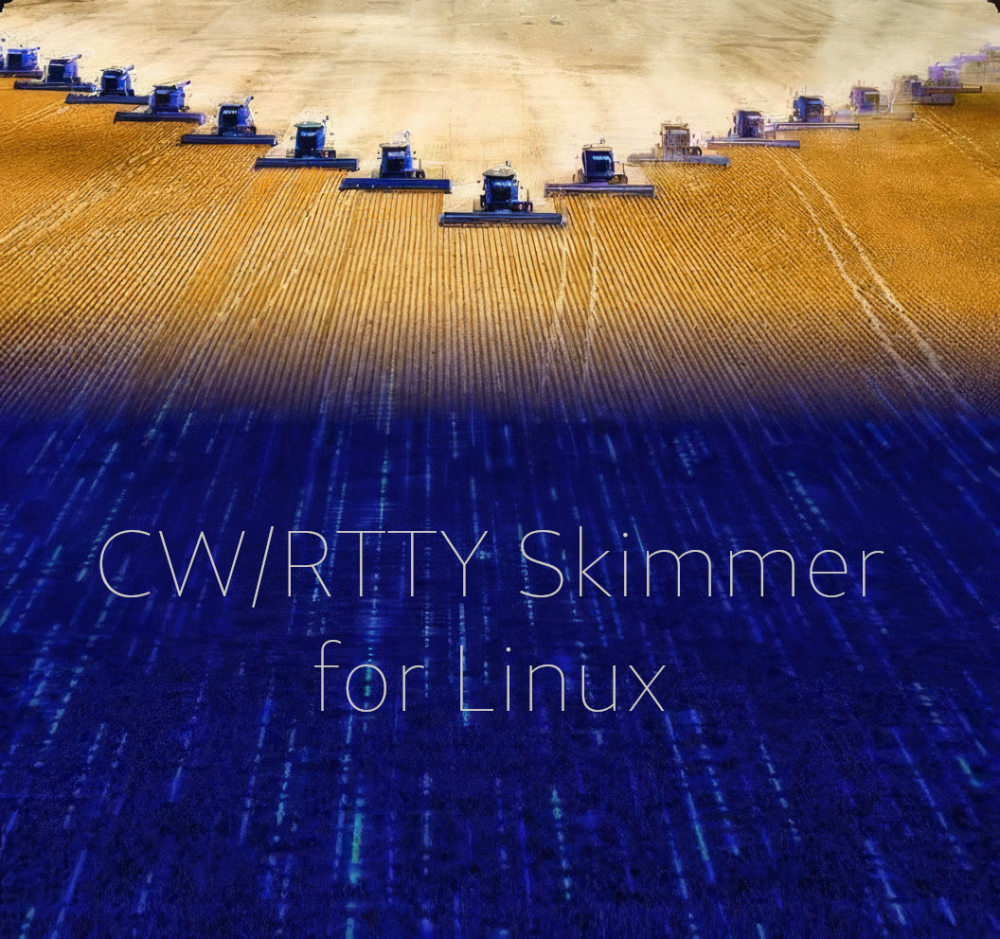

# Skimmer for Linux — headless multi-band skimmer



*Based on the Linux skimmer with a GUI by Richard, OK1BR — TNX!*

*Modified by Dan, OK1HRA, into a server application with a web interface that
skims several bands at once (up to 8), CW and RTTY, from a Red Pitaya SDR —
aiming for the performance of the legendary CW Skimmer Server by VE3NEA — TNX!
It currently uses a conventional decoder, with no neural networks, to keep the
hardware requirements low.*

## Quick start guide

**What you need**

- **A Red Pitaya** running Pavel Demin's `sdr_receiver_hpsdr`
  ([red-pitaya-notes](https://github.com/pavel-demin/red-pitaya-notes)). It
  is the only supported radio.
- **A wired network** to it. Automatic discovery works only in the same
  subnet.
- **An x86_64 Linux machine** with glibc 2.36 or newer. Debian 12 and 13 are
  tested.

**Steps**

1. Download `skimmer-headless-*-x86_64.AppImage` from the
   [latest release](https://github.com/ok1hra/skimmer-for-linux/releases/latest).
2. `chmod +x skimmer-headless-*-x86_64.AppImage`, then
   `./skimmer-headless-*-x86_64.AppImage --find-radios`. It should list your
   Red Pitaya as idle.
3. `./skimmer-headless-*-x86_64.AppImage` — the first run writes
   `~/.config/skimmer-for-linux/headless.ini` and starts skimming eight bands
   (160–10 m), CW and RTTY.
4. Open `http://localhost:8073/` → **Settings** and set your call. The telnet
   feed stays off without it. Then click *Save and restart*.
5. Point a logger or cluster client at `telnet localhost 7300`.
6. After a while, correct the Red Pitaya's clock (`clock_ppm`). See
   [First start](#first-start).
7. Optional: run it as a service
   (`--install-service`, [As a service](#as-a-service)).

**Limits — hardware (Red Pitaya)**

- **One Red Pitaya, up to 8 bands**, one receiver per band. All bands share
  one sample rate, which is also the width each band covers around its centre:
  48, 96 (default) or 192 kHz.
- **One client at a time.** The skimmer takes only an idle Red Pitaya and
  takes a busy one only with `--take-over`. If another program (Quisk, CW
  Skimmer Server) takes the radio over, the stream is lost and the skimmer
  exits with code 3; the service restarts it after a minute.
- **The antenna input** (IN1/IN2) of each receiver is chosen on the Red
  Pitaya, on the `sdr_receiver_hpsdr` command line. The skimmer cannot set it.
- **The clock is off by a few ppm** and must be corrected in the config.
  Uncorrected, 4 ppm puts 10 m spots ~110 Hz off, more than the RBN accepts.
- **Network:** 8 bands at 96 kHz are about 40 Mb/s of UDP, at 192 kHz about
  77 Mb/s. Over Wi-Fi, 192 kHz lost about 30 % of the packets.

**Limits — software**

- **The AppImage is x86_64 only** (glibc ≥ 2.36, FUSE or
  `APPIMAGE_EXTRACT_AND_RUN=1`). Other architectures, such as a Raspberry
  Pi, can only build from source, untested.
- **No GUI.** It has a web page and a console table. By default, settings can
  be changed only from the machine itself (`[web] settings_from`); from
  elsewhere, use an SSH tunnel.
- **Modes: CW and RTTY** (45.45 Bd, 170 Hz) only — no PSK and no other RTTY
  speeds.
- **CPU:** six 96 kHz CW bands used 70–85 % of one core on an i5-10210U.
  RTTY adds about 7.5 % of a core per band. The optional DeepCW decoder needs
  far more (about 3 % of a core per decoding channel).

> **This is a fork.** It is maintained by Dan, OK1HRA, from
> [OK1BR/skimmer-for-linux](https://github.com/OK1BR/skimmer-for-linux).
> Skimmer for Linux is the work of Richard Fakenberg, OK1BR; the fork has
> dropped its GTK application. Please report problems with the fork here,
> not upstream.

`skimmer-headless` takes IQ from one **Red Pitaya** running Pavel Demin's
`sdr_receiver_hpsdr` (HPSDR Protocol 1), up to 8 receivers at once, one band
each. Every band runs its own pipeline: a channelizer splits the band into
125 Hz channels, each channel runs a CW decoder (and, on the bands that ask
for it, a second pipeline decodes RTTY from the same IQ), and validated
callsigns go through a station table and a feed policy. The CQ spots of all bands go to
**one** telnet feed in the cluster dialect, the CW Skimmer Server model.
Status comes as a table on the console and as a web page with `/status.json`.

```
Red Pitaya ──UDP IQ, 1..8 receivers──► skimmer-headless ──► per band: channelizer ──► CW / RTTY decode
                                               │                                         │
                                               └── telnet cluster feed ◄── callsigns ◄───┘
```

The skimmer is **read-only towards the operator's radio**. The Red Pitaya is
the skimmer's own receiver: it sets that receiver's DDC centres, rate and
receiver count, never keys, and never takes a receiver another client is
streaming from unless told to (`--take-over`).

## What it does

- **CW**, decoded by the soft-decision Viterbi decoder (v2, the default) or the
  neural **DeepCW** model when an ONNX Runtime and the model are installed.
  The decoder and the RBN feed are tuned on live air against CW Skimmer
  Server (v0.6.0): IQ recorded beside live decoding was replayed and scored on
  the same antenna, and the winners became the defaults. Method, numbers and
  what was rejected: [`docs/LIVE-AIR.md`](docs/LIVE-AIR.md).
- **RTTY** (45.45 Bd, 170 Hz shift) beside CW on the bands that ask for it
  (`20m=14045500 cw,rtty`): a second pipeline on the same IQ, 250 Hz
  channels, its spots on the same feed as `RTTY … 45 BPS` (`[feed]
  rtty=false` keeps them off it). It costs about 7.5 % of one core per band
  at 96 kHz. `[decode] suppress_cw_on_rtty=true` keeps the band's CW
  decoders off the RTTY stations it copies (an FSK tone reads as junk CW);
  off until measured live.
- **The RBN feed** sends only validated CQ calls that were read twice (or are
  in MASTER.SCP), settled in the station table, and were read lately. A
  **learned feed gate** (a logistic model over what the pipeline knew when it
  spotted) is built in and runs in shadow: it scores every spot and reports,
  the hand gate decides. See [The feed gate](#the-feed-gate).
- **The Super Check Partial call list keeps itself current** in the background.
- **Learning and measuring:** a decode tap per band (`[feed] learn=true`), raw
  IQ recordings (`[record]`), and `skimmer-compare/`, which scores the feed
  against another skimmer with the Reverse Beacon Network as the referee.

## Install

The release is one file, an AppImage for x86_64 Linux with glibc 2.36 or
newer — tested on Debian 12 and 13 — attached to each
[GitHub release](https://github.com/ok1hra/skimmer-for-linux/releases). It
brings its libraries and the ONNX Runtime for DeepCW; the DeepCW model is
fetched on request ([DeepCW](#deepcw)).

```sh
chmod +x skimmer-headless-*-x86_64.AppImage
./skimmer-headless-*-x86_64.AppImage --find-radios      # the Red Pitayas on the LAN
./skimmer-headless-*-x86_64.AppImage                    # first run writes the config and starts
./skimmer-headless-*-x86_64.AppImage --install-service  # optional: run it as a service
```

Then [First start](#first-start): your call, the clock correction. Without
FUSE (no `/dev/fuse` or `fusermount`), set `APPIMAGE_EXTRACT_AND_RUN=1`. Run
`--install-service` again after moving the file.

## Build

Requirements: GLib/GIO ≥ 2.74, libsoup 3, libwebsockets, libcurl ≥ 7.85,
FFTW (single and double precision), `meson` and `ninja`. On Debian 12/13:

```sh
sudo apt install meson ninja-build libglib2.0-dev libsoup-3.0-dev libwebsockets-dev \
                 libfftw3-dev libcurl4-openssl-dev
git clone https://github.com/ok1hra/skimmer-for-linux.git
cd skimmer-for-linux
meson setup build
meson compile -C build
meson test -C build            # offline gates, no radio needed
```

The build produces `build/skimmer-headless` and the tools below.
`packaging/appimage/build.sh` builds the AppImage in a Debian 12 container
(podman) and runs every gate there first; `packaging/appimage/smoke.sh`
checks the result, here or in a clean Debian 12 (`--container`). The `golden`
gate replays recorded real air through the whole engine and needs inputs
that are not in git; without them it reports SKIP
([`tests/golden/README.md`](tests/golden/README.md)).

### Making a release

1. Set the version in `meson.build` (`version : 'X.Y.Z'`) and commit.
2. `packaging/appimage/build.sh` — the AppImage in a Debian 12 container
   (podman), every gate run there first (the golden one where its inputs
   are); `packaging/appimage/smoke.sh dist/*.AppImage --container --fetch`.
3. Tag and push: `git tag -a vX.Y.Z -m "release: vX.Y.Z"`,
   `git push origin main vX.Y.Z`.
4. `gh release create vX.Y.Z --verify-tag --title "Skimmer for Linux X.Y.Z"
   --notes-file NOTES.md dist/skimmer-headless-X.Y.Z-x86_64.AppImage`.
   CI (`.github/workflows/build.yml`) builds and smoke-tests the AppImage on
   the tag as well and attaches its own build to the release.

## Run

```sh
skimmer-headless [--config FILE] [--take-over] [--status-every S]
                 [--http-port N] [--feed-gate FILE]
                 [--feed-gate-mode off|shadow|on]
                 [--check-config] [--find-radios] [--list-switches]
                 [--fetch-deepcw-model]
                 [--install-service] [--uninstall-service]
```

(`skimmer-headless` = the AppImage, or `./build/skimmer-headless` from a build.)

### First start

1. **Find the radio.** `skimmer-headless --find-radios` lists the Red
   Pitayas on the LAN (they answer an HPSDR discovery broadcast) with their
   addresses, and whether another client streams from them.
2. **Run it once.** The first start writes
   `~/.config/skimmer-for-linux/headless.ini`, commented line by line, with
   the radios found on the LAN noted in it, and starts:
   - `host=auto` takes the first idle Red Pitaya on the LAN. To pin one, put
     its address there; a list is tried in order (`host=192.168.1.21,auto`).
     A radio on another subnet is not reached by a broadcast — name it.
   - eight bands (160, 80, 40, 30, 20, 17, 15, 10 m), CW and RTTY on each —
     a Red Pitaya has eight receivers; 12 m is in the file, commented out.
3. **Set your call** in `[feed] call=` — the telnet feed stays off until it
   is set — on the web page (`http://<host>:8073/`, Settings) or in the file.
4. **Correct the clock.** A Red Pitaya's clock is off by a few ppm and every
   spot lands `f × ppm` low (3.8 ppm = 53 Hz on 14 MHz; the Reverse Beacon
   Network wants less than 100 Hz). Run a while with `clock_ppm=0`, compare
   your spots with the RBN's spots of the same stations
   ([reversebeacon.net](https://www.reversebeacon.net)): yours `D` Hz low at
   `F` kHz on average gives `clock_ppm = D / F × 1000`. With a known carrier
   instead: `(true − shown) / true × 10⁶`. Several radios: `host=ADDRESS@ppm`
   gives each its own.

`--check-config` reads and checks the config and the feed gate, prints what
would run and exits — no radio is touched, nothing is written. A config that
does not parse stops the start with exit 2 and names the bad line.

Point a logger or a cluster client at `telnet <host> 7300`. Ctrl+C stops the
skimmer cleanly and frees the radio.

When every listed radio is busy, or none answers within 30 s, the skimmer
says which and exits with code 3 — also when the stream is lost later; the
service (`--install-service`) starts it again a minute later. Eight
receivers at 96 kHz are about 40 Mb/s of UDP, so **use a wired link**. Over
Wi-Fi, 192 kHz lost about 30 % of the packets. `[radio] type=mock` replaces
the radio with synthetic CW on every band (the headless gate uses it).

### As a service

```sh
skimmer-headless --install-service                # [--config FILE] to run another config
systemctl --user enable --now skimmer-headless
journalctl --user -u skimmer-headless -f
loginctl enable-linger $USER                      # once: keep running while logged out
```

`--install-service` writes `~/.config/systemd/user/skimmer-headless.service`
for this program (an AppImage puts its own path there) and an empty
`~/.config/skimmer-for-linux/headless.env` for `SKIM_*` variables. It starts
nothing. `--uninstall-service` stops the service and removes the unit; the
config and `headless.env` stay.

The exit codes drive the service:

| Exit | Meaning | The service |
| --- | --- | --- |
| 0 | stopped (SIGTERM, Ctrl+C) | stays stopped |
| 2 | the config is wrong | stays stopped — fix it, then `systemctl --user restart skimmer-headless` |
| 3 | no free radio, or the stream was lost | starts again after a minute |
| 75 | restart, for a supervisor that sets `SKIM_SUPERVISED=1` | starts again |

A crash also starts it again after a minute. A restart the web page asks
for (after *Save*) re-executes the program in place without a minute's
wait, under the service as well. Under the service the console table is
off; the web page shows the same.

### DeepCW

A band can decode CW with the neural DeepCW model instead of v2:
`20m=14045500 cw:deepcw`, or `[decode] engine=deepcw` for every band that
names no engine. It needs two things this program does not contain:

- **The model** — by e04, AGPL-3.0-only, from
  [e04/deepcw-engine](https://github.com/e04/deepcw-engine). The skimmer pins
  one commit of it and checks the sha256 of every file it fetches.
  `--fetch-deepcw-model` (or *Download* under Settings → Decoding) puts it
  in `~/.local/share/skimmer-for-linux/models/deepcw/`, with its licence and
  a NOTICE beside it. A file that does not match is refused and nothing is
  written.
- **ONNX Runtime** 1.21 or newer. The AppImage brings it (CPU); a build
  from source needs it installed (Debian 13: `apt install libonnxruntime1.21`).
  For a GPU, point `SKIM_ORT_LIB` at a system ONNX Runtime with CUDA and set
  `SKIM_DEEPCW_DEVICE=cuda`.

Without either one, a DeepCW band still starts but runs v2. The log, the
web page (in red) and `--check-config` say why, and a restart picks DeepCW
up once both are in place. DeepCW uses far more CPU than v2: about 3 % of a
core for every channel it is decoding.

## The web page

`http://<host>:8073/` shows the skimmer: **Status** (radio, CPU, loss, the
feed, every band with its newest stations, the feed policy, the learned gate
and the `SKIM_*` switches), **Statistics** (seven days, one record a minute,
kept across restarts in `~/.local/state/skimmer-for-linux/stats.bin`: spots
per hour by band, active decoders, CPU, IQ loss, totals), **Settings** and
**Log**. It needs no internet; the JSON behind it is `/status.json`,
`/stats.json`, `/api/log` and `/api/config` (and `POST /api/deepcw`, the
model fetch).

**Settings** edits the radio, the bands (order, centre, CW engine, RTTY), the
feed's call and port, the status ports and the IQ recording, and fetches the
DeepCW model. *Save and
restart* checks the new config with the same parser the start uses — a bad
value is refused and nothing is written — keeps the previous file as
`headless.ini.bak-<UTC>` (the last 10; *Earlier configs* restores any of
them) and restarts the skimmer. A start that does not get the radio
streaming within a minute of a change offers the previous config back. The
feed policy, the learned gate and `[web]` are not editable on the page.

Only the addresses in `[web] settings_from` (default `127.0.0.1,::1`) may
change settings; everyone else sees them read-only. From another machine
use a tunnel: `ssh -L 8073:127.0.0.1:8073 <host>`, then
`http://localhost:8073/`. A restart re-executes the skimmer; under a
supervisor that sets `SKIM_SUPERVISED=1` it exits with code 75 instead.

## The feed gate

The learned gate's weights are part of the code
([`weights/feed-gate.ini`](weights/feed-gate.ini)); a new model is a new
commit of that file. A start may run another model or another mode:

| Switch | Config | Effect |
| --- | --- | --- |
| `--feed-gate FILE` | `[feed] gate=FILE` | Run this model instead of the built-in one. It must name every feature, or the start stops (exit 2). |
| `--feed-gate-mode shadow` | `[feed] gate_mode=` | Default: score every spot and report, the hand gate decides. |
| `--feed-gate-mode on` | | Hold back the spots the model scores below its threshold. |
| `--feed-gate-mode off` | | No learned gate. |

The command line wins over the config. The log and `/status.json`
(`feed_gate.id`) name the model as `builtin:feed-gate.ini#<sha8>` or
`file:<name>#<sha8>`, so a measurement can tell its periods apart.

## Tools

| Binary | What |
| --- | --- |
| `skimmer-hpsdr-probe` | Live check of a receiver: discovery, packet loss, effective rate, the strongest peaks at absolute frequencies, optional IQ dump |
| `skimmer-replay` | Decode a recorded `.cf32` offline through the whole pipeline, with the feed traced |
| `skimmer-tap-replay` | Replay a decode tap through the feed policy and the learned gate |
| `skimmer-cw-bench` | CW decoder bench on synthetic keying |
| `skimmer-tci-probe` | IQ ingest from a TCI server (the engine still has a TCI client) |

## Compare two skimmers (`skimmer-compare/`)

```sh
cd skimmer-compare
./capture-spots.sh -c YOURCALL -r <cw-skimmer-host>:<port>   # records local, remote and RBN feeds into logs/
./compare-web.py                                             # live comparison at http://localhost:8074/
```

`compare.ini` sets the labels, the remote's receive windows and the matching
defaults. `test-capture.py` and `test-compare.py` are offline self-tests.
It needs bash, curl and Python 3, standard library only.

## Files

| Path | What |
| --- | --- |
| `~/.config/skimmer-for-linux/headless.ini` | Settings (`headless.ini.bak-<UTC>`: the last 10 saved from the web page) |
| `~/.config/skimmer-for-linux/headless.env` | `SKIM_*` variables for the service (`--install-service`) |
| `~/.config/skimmer-for-linux/master.scp` | Super Check Partial call list (`.state` records the update rate limits) |
| `~/.local/share/skimmer-for-linux/headless/` | Decode logs (`[decode] log=true`), decode taps (`learn/`) |
| `~/.local/share/skimmer-for-linux/models/deepcw/` | DeepCW model (`--fetch-deepcw-model`), its LICENSE and NOTICE |
| `~/.local/state/skimmer-for-linux/stats.bin` | Seven days of statistics for the web page |

## Environment variables

`--list-switches` prints every `SKIM_*` switch the engine reads. The ones set
at start are logged and listed in `/status.json` (`switches`); a `SKIM_*`
name the engine does not read is warned about.

| Variable | Effect |
| --- | --- |
| `SKIM_CW_V1=1` | Use the classical CW decoder |
| `SKIM_CW_ENGINE=v1\|v2\|deepcw` | Pick the CW engine for this run |
| `SKIM_TONE_SPLIT=1` | Decode two stations in one channel separately — opt-in, awaiting its live validation |
| `SKIM_TONE_FOCUS=1` | Narrow the channel filter onto a lone carrier (implies the splitter) — same status |
| `SKIM_ORT_LIB=<path>` | ONNX Runtime library for DeepCW (e.g. a system one with CUDA) |
| `SKIM_DEEPCW_DEVICE=cuda` | Run DeepCW on the GPU, when that library has CUDA |
| `SKIM_DEEPCW_MODEL=<path>` | Take the DeepCW model from somewhere else |
| `SKIM_SCP_URL=<url>` | Take the call list from somewhere else |

The decoder and the feed have more `SKIM_*` switches for the live-air work;
[`docs/LIVE-AIR.md`](docs/LIVE-AIR.md) describes them.

## Credits

- **Richard Fakenberg, OK1BR** ([rifak.cz](https://rifak.cz)) wrote Skimmer
  for Linux: the engine, the channelizer, the CW and RTTY decoders, callsign
  validation, the spot pipeline. This fork only builds on his work. Many
  thanks.
- **Pavel Demin** wrote [red-pitaya-notes](https://github.com/pavel-demin/red-pitaya-notes)
  and its `sdr_receiver_hpsdr`, the receiver this fork talks to.
- **VE3NEA** wrote CW Skimmer Server, the reference used for the comparisons.
- The fork's changes were written by Dan, OK1HRA, with the help of Claude Code.

## Licence

GPL-3.0-or-later. See [`LICENSE`](LICENSE).
